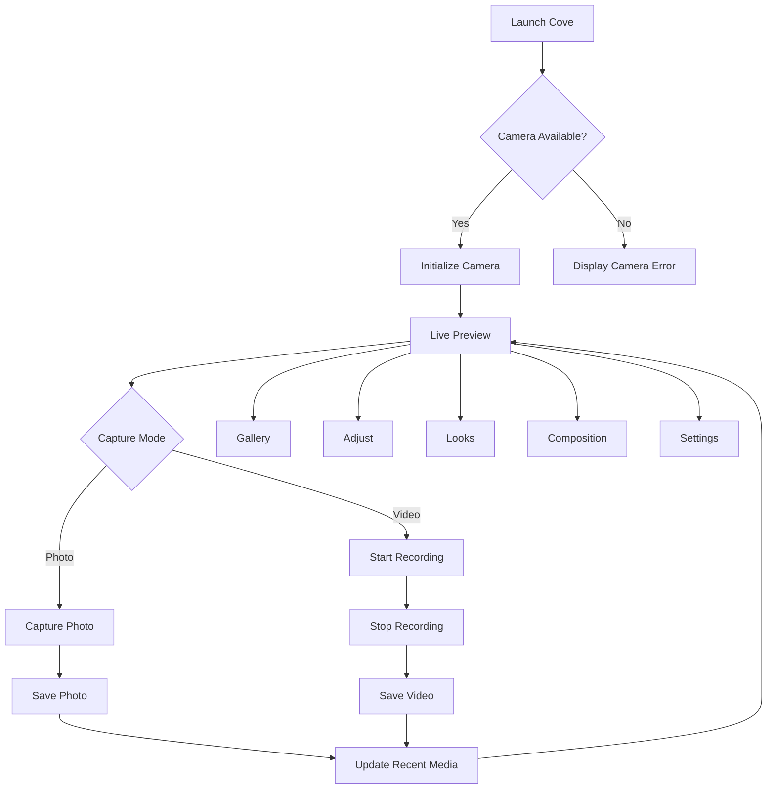

# Product Requirements Document (PRD)

> **Document Status:** Draft  
> **Last Updated:** November 23, 2026  
> **Product Manager:** Project Owner  
> **Contributors:** Solo Developer, AI-assisted Development

---

# Executive Summary

**Product Name:** Cove

**Problem Statement:**

macOS users who want to use their camera for photography or video capture may find existing camera applications either too limited, unnecessarily complicated, or restricted by paid features and subscriptions. Users who simply want a comfortable camera experience with basic manual controls, adjustments, and composition tools may not need a complicated professional editing workflow.

**Proposed Solution:**

Cove is a native macOS camera application designed around simplicity, control, and a refined visual experience. It combines live camera preview, photo and video capture, practical camera controls, image adjustments, composition tools, and a local media gallery in a minimal and distraction-free interface.

**Success Metrics:**

- Successfully initialize and display a live camera preview on supported macOS devices.
- Complete photo capture and video recording with reliable local saving.
- Maintain a responsive interface during camera operations and image processing.
- Implement the core camera workflow without requiring an account, subscription, advertisement, or cloud service.

**Launch Target:** TBD — dependent on development progress.

---

# Background & Context

## Why Now?

Cove is a personal software project intended to provide a camera experience that the developer wants to use on macOS.

Rather than building a complicated professional camera system, Cove focuses on essential camera functionality, practical controls, and a carefully designed native interface.

The project also serves as an opportunity to explore native macOS development using Swift and SwiftUI, including camera integration, image processing, UI architecture, and macOS system integration.

The project is not driven by commercial objectives or the need to compete directly with professional camera software.

## User Research & Insights

- **Research Methods:** Initial product ideation, personal usage needs, feature exploration, and informal comparison of existing camera applications.

- **Key Findings:**
  - A camera application should prioritize the camera preview and capture experience.
  - Basic manual controls and image adjustments should be accessible without creating a complicated interface.
  - A local-first camera application without subscription restrictions is desirable for personal usage.
  - A refined native macOS interface can make the camera experience more enjoyable.
  - Camera configuration and adjustment features should be progressively accessible rather than always visible.

- **User Quotes:**

  > "I want a camera application on macOS that feels simple, looks premium, and gives me enough control without unnecessary restrictions."

  This is a product vision statement, not a quote collected from external research participants.

## Market Analysis

- **Market Size:** Not applicable. Cove is a personal, non-commercial software project.

- **Competitive Landscape:**
  - Built-in macOS camera workflows and applications.
  - Third-party camera applications for macOS.
  - Photography applications offering capture and image adjustment capabilities.

- **Differentiation:**
  - Personal and unrestricted usage.
  - No subscriptions or advertisements.
  - Minimal and camera-first interface.
  - Local media storage.
  - Native macOS technologies.
  - Practical camera features without unnecessary complexity.
  - Quiet Premium design philosophy.

---

# Goals & Success Criteria

## Business Goals

1. Build a functional and stable personal camera application for macOS.
2. Create a maintainable native macOS codebase using Swift and SwiftUI.
3. Develop a polished camera experience that can be expanded gradually.

## User Goals

1. Capture photos and videos conveniently using their Mac camera or compatible external camera.
2. Adjust camera settings and image appearance without leaving the application.
3. Preview, browse, and manage captured media locally.

## Success Metrics (Detailed)

| Metric                 | Baseline        | Target                                              | Timeframe | Measurement Method              |
| ---------------------- | --------------- | --------------------------------------------------- | --------- | ------------------------------- |
| Camera initialization  | Not implemented | Successfully initialize supported camera            | MVP       | Manual testing                  |
| Live preview           | Not implemented | Stable preview on supported devices                 | MVP       | Functional testing              |
| Photo capture          | Not implemented | Successfully capture and save photos                | MVP       | Capture and file verification   |
| Video recording        | Not implemented | Successfully record and save videos                 | MVP       | Recording and file verification |
| Gallery functionality  | Not implemented | Browse and open locally saved media                 | MVP       | Functional testing              |
| UI responsiveness      | Not implemented | No unnecessary UI blocking during capture           | MVP       | Manual performance testing      |
| Permission handling    | Not implemented | Clear handling of camera and microphone permissions | MVP       | Permission testing              |
| Basic image adjustment | Not implemented | Implement functional basic adjustments              | Post-MVP  | Adjustment testing              |
| Composition guides     | Not implemented | Display configurable composition overlays           | Post-MVP  | UI testing                      |

## Non-Goals (Out of Scope)

- Commercial monetization.
- Subscription system.
- Advertisement system.
- User accounts.
- Cloud synchronization.
- Social media integration.
- Online media storage.
- Professional video editing timeline.
- AI image generation.
- Multi-camera production workflow.
- Windows or Linux support.
- iOS or iPadOS versions.
- App Store distribution requirements as a project necessity.

---

# User Personas & Use Cases

## Primary Persona: Personal Camera User

- **Role:** Individual macOS user.
- **Goals:** Capture photos and videos, adjust camera settings, improve image appearance, and manage captured media.
- **Pain Points:** Unnecessary complexity, restricted features, paid features, cluttered camera interfaces, and limited access to practical adjustments.
- **Technical Proficiency:** Intermediate.
- **Context:** Uses the application for personal photography, video recording, experimenting with composition, and casual content creation.

## Secondary Persona: Creative Explorer

- **Role:** Hobbyist interested in photography, visual experimentation, and camera settings.
- **Goals:** Experiment with camera configurations, image adjustments, composition, and visual presets.
- **Pain Points:** Limited camera controls, lack of accessible adjustment tools, and complicated editing workflows.
- **Technical Proficiency:** Beginner to Intermediate.
- **Context:** Uses Cove to experiment with image appearance and camera settings without needing a separate professional editing application.

## Key Use Cases

### Use Case 1: Capture a Photo

**Actor:** Personal Camera User

**Preconditions:**

- Cove is running.
- A compatible camera is available.
- Camera permission has been granted.

**Flow:**

1. User opens Cove.
2. System initializes the selected camera.
3. System displays live camera preview.
4. User selects Photo mode.
5. User presses the capture button.
6. System captures the image.
7. System saves the image locally.
8. System updates the recent media thumbnail.

**Expected Outcome:** A photo is successfully captured and saved locally.

**Edge Cases:**

- Camera is unavailable.
- Camera permission is denied.
- Capture operation fails.
- Storage location is unavailable.
- Insufficient storage space.

### Use Case 2: Record a Video

**Actor:** Personal Camera User

**Preconditions:**

- Cove is running.
- A compatible camera is available.
- Camera permission has been granted.

**Flow:**

1. User opens Cove.
2. System initializes the camera.
3. User selects Video mode.
4. User presses the recording button.
5. System starts video recording.
6. System displays recording status and duration.
7. User presses the recording button again.
8. System stops recording.
9. System saves the video locally.
10. System updates the recent media thumbnail.

**Expected Outcome:** A video is successfully recorded and saved locally.

**Edge Cases:**

- Camera is disconnected during recording.
- Microphone permission is denied.
- Recording initialization fails.
- Recording output cannot be saved.
- Storage space becomes insufficient.

### Use Case 3: Adjust Image Appearance

**Actor:** Creative Explorer

**Preconditions:**

- Camera preview is active or a supported image is available for preview processing.

**Flow:**

1. User navigates to Adjust.
2. System displays available adjustment controls.
3. User selects an adjustment.
4. User changes the adjustment value.
5. System updates the preview.
6. User continues adjusting the image.
7. User resets an adjustment or all adjustments if necessary.

**Expected Outcome:** The preview reflects the user's adjustment settings.

**Edge Cases:**

- Adjustment is unsupported by the current processing pipeline.
- Processing causes preview delay.
- Camera preview is interrupted.
- Adjustment state is reset unexpectedly.

### Use Case 4: Browse Captured Media

**Actor:** Personal Camera User

**Preconditions:**

- Captured media exists in the local storage location.

**Flow:**

1. User selects the recent media thumbnail.
2. System opens the gallery.
3. System displays locally stored photos and videos.
4. User selects a media item.
5. System opens the media preview.
6. User can navigate, delete, or reveal the media in Finder.

**Expected Outcome:** User can browse and manage locally captured media.

**Edge Cases:**

- Media file no longer exists.
- Thumbnail generation fails.
- Media file is corrupted.
- Gallery loading takes longer than expected.

---

# Product Requirements

## Functional Requirements

### Must Have (P0) - MVP

#### 1. Live Camera Preview

- **Description:** Display live video feed from the selected camera.

- **User Story:** As a user, I want to see a live camera preview so that I can frame my photo or video before capturing it.

- **Acceptance Criteria:**
  - [x] Cove can detect available compatible cameras.
  - [x] Cove can initialize a selected camera.
  - [x] Live camera preview is displayed.
  - [x] Camera initialization errors are handled.
  - [x] Preview updates when the selected camera changes.
  - [x] Camera permission is requested appropriately.

#### 2. Camera Selection

- **Description:** Allow users to select an available camera.

- **User Story:** As a user, I want to select a camera so that I can use the camera device I prefer.

- **Acceptance Criteria:**
  - [x] Available camera devices are displayed.
  - [x] The selected camera is identifiable.
  - [x] Camera switching updates the preview.
  - [x] Unavailable cameras are handled.
  - [x] Camera device changes are handled appropriately.

#### 3. Photo Capture

- **Description:** Capture and save still images locally.

- **User Story:** As a user, I want to capture photos so that I can save moments and images locally.

- **Acceptance Criteria:**
  - [x] Photo mode is available.
  - [x] The capture button triggers photo capture.
  - [x] Captured images can be saved locally.
  - [x] Capture feedback is provided.
  - [x] Saving errors are handled.
  - [x] The recent media thumbnail is updated after successful capture.

#### 4. Video Recording

- **Description:** Record videos using a compatible camera.

- **User Story:** As a user, I want to record videos so that I can capture moving moments.

- **Acceptance Criteria:**
  - [x] Video mode is available.
  - [x] Recording can be started.
  - [x] Recording can be stopped.
  - [x] Recording status is displayed.
  - [x] Recording duration is displayed.
  - [x] Videos are saved locally.
  - [x] Recording errors are handled.
  - [x] The recent media thumbnail is updated after successful recording.

#### 5. Local Media Saving

- **Description:** Save captured media to a local storage location.

- **User Story:** As a user, I want captured media to be saved locally so that I can access my files without relying on cloud services.

- **Acceptance Criteria:**
  - [x] Captured photos are saved locally.
  - [x] Captured videos are saved locally.
  - [x] The application uses a configurable save location.
  - [x] The application handles unavailable save locations.
  - [x] The application handles insufficient storage.
  - [x] Saved media can be accessed through Finder.

#### 6. Capture Interface

- **Description:** Provide a camera-focused main interface.

- **User Story:** As a user, I want the camera interface to be simple so that I can capture content without unnecessary distractions.

- **Acceptance Criteria:**
  - [x] The main preview occupies the primary visual area.
  - [x] The right-side panel contains capture controls.
  - [x] Photo and Video modes are accessible.
  - [x] The capture button is clearly visible.
  - [x] Recent media access is available.
  - [x] Navigation to other features is accessible.

#### 7. Appearance Support

- **Description:** Support light, dark, and system appearance.

- **User Story:** As a user, I want to choose the application's appearance so that Cove matches my preferred macOS environment.

- **Acceptance Criteria:**
  - [x] Light appearance is supported.
  - [x] Dark appearance is supported.
  - [x] System appearance is supported.
  - [x] Appearance changes are applied consistently.
  - [x] UI elements maintain appropriate contrast.

#### 8. Camera and Microphone Permission Handling

- **Description:** Handle macOS camera and microphone permissions.

- **User Story:** As a user, I want clear permission handling so that I understand why the camera or microphone is unavailable.

- **Acceptance Criteria:**
  - [x] Camera access is requested when necessary.
  - [x] Microphone access is requested when necessary.
  - [x] Permission-denied states are handled.
  - [x] Users receive clear guidance when access is unavailable.
  - [x] The application does not request unnecessary permissions.

#### 9. Local Gallery

- **Description:** Provide a simple gallery for browsing captured media.

- **User Story:** As a user, I want to browse captured photos and videos so that I can access my content directly from Cove.

- **Acceptance Criteria:**
  - [x] Gallery displays locally captured media.
  - [x] Photos and videos can be identified.
  - [x] Thumbnails are displayed.
  - [x] Media can be opened.
  - [x] Media can be deleted.
  - [x] Media can be revealed in Finder.

---

### Should Have (P1) - Post-Launch

#### 1. Basic Image Adjustments

- **Description:** Provide practical image adjustment tools.

- **User Story:** As a user, I want to adjust the image appearance so that I can improve the captured image or preview.

- **Acceptance Criteria:**
  - [x] Brightness adjustment is available.
  - [x] Contrast adjustment is available.
  - [x] Saturation adjustment is available.
  - [x] Exposure adjustment is available where appropriate.
  - [x] Highlights and shadows adjustments are available.
  - [x] Sharpness adjustment is available.
  - [x] Adjustments update the preview.
  - [x] Individual adjustments can be reset.
  - [x] All adjustments can be reset.

#### 2. Composition Guides

- **Description:** Provide visual guides to help users frame images.

- **User Story:** As a user, I want composition guides so that I can frame my images more accurately.

- **Acceptance Criteria:**
  - [x] Rule of thirds guide is available.
  - [x] Center guide is available.
  - [x] Square grid is available.
  - [x] Guides can be enabled or disabled.
  - [x] Guides do not permanently modify captured media.

#### 3. Countdown Timer

- **Description:** Provide a countdown before capture.

- **User Story:** As a user, I want a countdown timer so that I can prepare before capturing an image.

- **Acceptance Criteria:**
  - [x] Countdown can be disabled.
  - [x] 3-second countdown is available.
  - [x] 5-second countdown is available.
  - [x] 10-second countdown is available.
  - [x] Countdown feedback is displayed.

#### 4. Camera Configuration

- **Description:** Provide access to supported camera configurations.

- **User Story:** As a user, I want to configure my camera so that I can control the capture experience.

- **Acceptance Criteria:**
  - [ ] Supported camera settings are exposed.
  - [ ] Unsupported settings are not presented as functional controls.
  - [ ] Camera configuration changes are handled safely.
  - [ ] Configuration changes provide appropriate feedback.

#### 5. Video Configuration

- **Description:** Provide configurable video recording options.

- **User Story:** As a user, I want to configure video recording so that I can choose suitable recording quality.

- **Acceptance Criteria:**
  - [ ] Available video resolution options can be selected.
  - [ ] Supported frame rates can be selected.
  - [ ] Microphone options are available where supported.
  - [ ] Audio recording can be enabled or disabled.
  - [ ] Unsupported configurations are handled.

#### 6. Aspect Ratio

- **Description:** Provide preview framing options.

- **User Story:** As a user, I want to change the preview aspect ratio so that I can frame my images differently.

- **Acceptance Criteria:**
  - [x] Default camera ratio is available.
  - [x] 1:1 is available where supported.
  - [x] 4:3 is available where supported.
  - [x] 16:9 is available where supported.
  - [x] Preview framing updates when the ratio changes.

---

### Nice to Have (P2) - Future Consideration

#### 1. Looks and Presets

- **Description:** Provide visual presets for preview and image processing.

- **User Story:** As a user, I want visual presets so that I can quickly experiment with different image appearances.

- **Acceptance Criteria:**
  - [x] Natural preset is available.
  - [x] Warm preset is available.
  - [x] Cool preset is available.
  - [x] Cinema preset is available.
  - [x] Mono preset is available.
  - [x] Soft preset is available.
  - [x] Presets can be previewed.
  - [x] Presets can be adjusted after application.

#### 2. Burst Capture

- **Description:** Capture multiple consecutive images.

- **User Story:** As a user, I want burst capture so that I can capture multiple frames quickly.

- **Acceptance Criteria:**
  - [x] Burst capture can be triggered.
  - [x] Multiple frames can be captured.
  - [x] Capture operations do not unnecessarily block the UI.
  - [x] Captured frames can be saved locally.

#### 3. Custom Presets

- **Description:** Allow users to save custom image adjustment combinations.

- **User Story:** As a user, I want to save my preferred adjustments so that I can reuse them.

- **Acceptance Criteria:**
  - [x] Users can save custom adjustment combinations.
  - [x] Custom presets can be selected.
  - [x] Custom presets can be deleted.
  - [x] Presets are stored locally.

#### 4. Level Indicator

- **Description:** Provide a visual level indicator for framing.

- **User Story:** As a user, I want a level indicator so that I can align my camera more accurately.

- **Acceptance Criteria:**
  - [ ] A level indicator can be displayed when supported.
  - [ ] The indicator reflects available orientation information.
  - [ ] The indicator can be enabled or disabled.

#### 5. Advanced Camera Profiles

- **Description:** Allow users to save preferred camera configurations.

- **User Story:** As a user, I want camera profiles so that I can quickly switch between preferred configurations.

- **Acceptance Criteria:**
  - [ ] Profiles can be created.
  - [ ] Profiles can be applied.
  - [ ] Profiles can be renamed.
  - [ ] Profiles can be deleted.
  - [ ] Profiles are stored locally.

---

## Non-Functional Requirements

### Performance

- Camera preview should remain smooth within hardware limitations.
- UI interactions should remain responsive.
- Camera initialization should not unnecessarily block the UI.
- Image processing should avoid unnecessary main-thread work.
- Gallery loading should avoid unnecessary blocking.
- Thumbnail generation should be handled efficiently.
- Resource usage should remain reasonable.

### Security & Privacy

- No user account system.
- No cloud storage.
- No external media upload.
- No advertising tracking.
- No unnecessary analytics.
- Camera permission must be handled through macOS permission mechanisms.
- Microphone permission must be handled through macOS permission mechanisms.
- Captured media should remain on local storage unless the user explicitly moves or shares it.
- Local files should not be accessed beyond necessary application functionality.

### Scalability

Cove is a personal desktop application and does not require server-side scalability.

Scalability within the application refers to:

- Support for different compatible camera devices.
- Modular feature architecture.
- Ability to add additional camera settings.
- Ability to add more image processing features.
- Ability to expand the gallery.
- Ability to add new presets without redesigning the architecture.

### Accessibility

- Support macOS accessibility features where practical.
- Use meaningful labels for controls.
- Support keyboard interaction.
- Maintain sufficient contrast.
- Respect Reduce Motion.
- Avoid relying solely on color to communicate status.
- Support VoiceOver where practical.

### Browser/Platform Support

- **Platform:** macOS.
- **Minimum OS:** macOS 12 Monterey.
- **UI Framework:** SwiftUI.
- **Language:** Swift.
- **Camera Framework:** AVFoundation.
- **Image Processing:** Core Image.
- **Platform Integration:** AppKit.

No browser, Windows, Linux, iOS, or Android support is planned.

---

# User Experience & Design

## User Flow Diagram

## Wireframes/Mockups

The initial interface should follow the agreed layout:

- Main camera preview on the left and central area.
- Camera controls on the right.
- Capture mode and capture button within the right-side control region.
- Recent media thumbnail in the bottom-right area.
- Navigation at the top.
- Minimal visual distractions.

The visual design should follow the **Quiet Premium** direction.

A separate `Design_System.md` will define the UI components, typography, color palette, spacing, materials, interactions, and design tokens in detail.

## Key Interactions

### 1. Camera Capture

- **Trigger:** User presses the capture button.
- **Behavior:** The application captures a photo or starts/stops recording based on the selected mode.
- **Feedback:** Capture animation, recording indicator, or appropriate status feedback.

### 2. Camera Switching

- **Trigger:** User selects a different camera.
- **Behavior:** The active camera session is updated.
- **Feedback:** Preview updates to the selected camera.

### 3. Navigation

- **Trigger:** User selects a top navigation item.
- **Behavior:** The application displays the selected feature.
- **Feedback:** Selected navigation state is highlighted.

### 4. Image Adjustments

- **Trigger:** User changes an adjustment slider.
- **Behavior:** The preview updates according to the selected adjustment.
- **Feedback:** Updated preview and displayed adjustment value.

### 5. Gallery Access

- **Trigger:** User selects the recent media thumbnail.
- **Behavior:** The gallery or media viewer is opened.
- **Feedback:** Captured media is displayed.

### 6. Recording

- **Trigger:** User presses the recording button.
- **Behavior:** Video recording begins or stops.
- **Feedback:** Recording state and duration are displayed.

### 7. Appearance Switching

- **Trigger:** User changes appearance settings.
- **Behavior:** The application changes appearance.
- **Feedback:** UI updates to Light, Dark, or System mode.

## Design Principles for This Product

- Prioritize the camera preview.
- Minimize unnecessary interactions.
- Keep the main camera workflow simple.
- Use progressive disclosure for advanced controls.
- Avoid unnecessary UI decoration.
- Use native macOS interaction patterns.
- Maintain a refined visual hierarchy.
- Use subtle motion.
- Keep UI feedback clear.
- Maintain a consistent Quiet Premium visual identity.

---

# Technical Specifications

## System Architecture

Cove uses a native macOS architecture based on Swift and SwiftUI.

### UI Layer

**Technology:** SwiftUI

Responsibilities:

- Main window.
- Navigation.
- Camera controls.
- Adjustment panels.
- Gallery UI.
- Settings UI.
- State management.

### Camera Engine

**Technology:** AVFoundation

Responsibilities:

- Camera discovery.
- Camera selection.
- Camera session management.
- Live preview.
- Photo capture.
- Video recording.
- Camera configuration.

### Image Processing Engine

**Technology:** Core Image

Responsibilities:

- Image adjustments.
- Presets.
- Color processing.
- Preview processing.

### macOS Integration

**Technology:** AppKit

Responsibilities:

- macOS-specific integrations.
- Window behavior where necessary.
- Native functionality not adequately covered by SwiftUI.
- Finder integration.
- System interaction.

### Storage Layer

**Technology:** FileManager and local file storage.

Responsibilities:

- Saving captured photos.
- Saving captured videos.
- Managing save locations.
- Reading local media.
- Deleting media.
- File access.

## Data Model

### CameraDevice

Represents an available camera device.

Potential properties:

- Device ID.
- Device name.
- Device type.
- Availability.
- Supported configurations.

### CaptureConfiguration

Represents camera capture configuration.

Potential properties:

- Capture mode.
- Resolution.
- Frame rate.
- Exposure configuration.
- Focus configuration.
- White balance.
- Audio configuration.

### MediaItem

Represents a captured media file.

Potential properties:

- ID.
- File path.
- Media type.
- Capture date.
- File size.
- Resolution.
- Video duration where applicable.
- Thumbnail reference.

### AdjustmentState

Represents image adjustment values.

Potential properties:

- Brightness.
- Contrast.
- Saturation.
- Exposure.
- Highlights.
- Shadows.
- Sharpness.
- Temperature.
- Tint.

### Preset

Represents a predefined or custom adjustment configuration.

Potential properties:

- ID.
- Name.
- Adjustment values.
- Preset category.
- Custom preset status.

### AppSettings

Represents application preferences.

Potential properties:

- Appearance.
- Save location.
- Capture format.
- Video configuration.
- Audio configuration.
- Default composition guide.
- Default aspect ratio.

## API Requirements

Cove does not require external APIs or backend endpoints.

The application will use local native APIs and framework interfaces provided by macOS.

| API / Framework | Purpose              | Usage                                    |
| --------------- | -------------------- | ---------------------------------------- |
| AVFoundation    | Camera and recording | Camera sessions, photo and video capture |
| Core Image      | Image processing     | Adjustments and presets                  |
| SwiftUI         | UI                   | Main application interface               |
| AppKit          | macOS integration    | Native platform features                 |
| FileManager     | Storage              | Local file management                    |

## Third-Party Integrations

- **None planned for the initial release.**

The project should avoid unnecessary third-party dependencies.

## Technical Constraints

- Minimum target: macOS 12 Monterey.
- Camera availability depends on the device and system.
- Camera controls depend on the selected camera hardware.
- External camera compatibility depends on AVFoundation and device support.
- Some image processing features may require a separate processing pipeline.
- Certain video resolutions and frame rates may not be available on all devices.
- Microphone availability depends on system permissions and hardware.
- SwiftUI and macOS APIs may vary between macOS versions.
- Camera session management must avoid unnecessary UI blocking.
- The initial project is limited to macOS.
- Cove does not require a backend server.

## Analytics & Tracking

Cove will not implement external analytics or telemetry in the initial release.

#### Events to Track

| Event Name                  | Trigger                                 | Properties            | Purpose                 |
| --------------------------- | --------------------------------------- | --------------------- | ----------------------- |
| `camera_initialized`        | Camera session successfully initialized | Camera type           | Development debugging   |
| `photo_captured`            | Photo capture completed                 | Capture configuration | Functional verification |
| `video_recording_started`   | Recording begins                        | Video configuration   | Functional verification |
| `video_recording_completed` | Recording ends                          | Recording duration    | Functional verification |
| `media_saved`               | Media saved successfully                | Media type            | Functional verification |
| `camera_error`              | Camera operation fails                  | Error category        | Error investigation     |

These events are intended for development diagnostics only. They should not imply external telemetry or user tracking.

---

# Go-to-Market Strategy

## Launch Plan

- **Beta/Alpha Testing:** Personal testing on the developer's Mac and compatible camera devices.
- **Phased Rollout:** Not applicable to commercial distribution. Development will proceed through internal builds.
- **Launch Date:** TBD.
- **Launch Channels:** Personal distribution, private builds, or GitHub if the project is eventually made public.

## Marketing & Positioning

- **Value Proposition:** A simple, refined, and capable native macOS camera application designed around capturing moments without unnecessary restrictions.

- **Key Messages:**
  - A camera experience designed for macOS.
  - Capture without unnecessary distractions.
  - Practical camera controls in a refined interface.
  - No subscriptions or advertisements.
  - Local-first media management.

- **Marketing Channels:** Not applicable to the initial personal project.

## Sales Enablement (if B2B)

- **Sales Materials:** Not applicable.
- **Pricing/Packaging:** Free personal use.
- **Training Required:** Not applicable.

## Support & Documentation

- **User Documentation:** Basic usage documentation may be created after the MVP.
- **Support Team Training:** Not applicable.
- **FAQ:** May be created if the application is shared publicly.

---

# Dependencies & Risks

## Dependencies

| Dependency                 | Owner     | Status               | Impact if Delayed                 | Mitigation                                       |
| -------------------------- | --------- | -------------------- | --------------------------------- | ------------------------------------------------ |
| Swift                      | Developer | Required             | Application development blocked   | Use supported Swift toolchain                    |
| SwiftUI                    | Developer | Required             | UI development blocked            | Use native framework                             |
| AVFoundation               | Developer | Required             | Camera functionality blocked      | Validate camera APIs early                       |
| Core Image                 | Developer | Required             | Processing features delayed       | Implement adjustments incrementally              |
| AppKit                     | Developer | Optional/Supporting  | macOS integrations may be delayed | Use only where necessary                         |
| Compatible camera hardware | Developer | Required for testing | Camera testing blocked            | Test with available built-in or external cameras |
| macOS 12+ environment      | Developer | Required             | Platform testing blocked          | Validate target OS and available APIs            |

## Risks & Mitigation

### High Risk

#### 1. Camera Compatibility

- **Probability:** Medium.
- **Impact:** High.
- **Mitigation:** Test camera discovery, preview, capture, and recording with different camera devices as early as possible.
- **Owner:** Developer.

#### 2. Camera Session Stability

- **Probability:** Medium.
- **Impact:** High.
- **Mitigation:** Separate camera session management from UI logic and test session lifecycle behavior.
- **Owner:** Developer.

#### 3. Image Processing Performance

- **Probability:** Medium.
- **Impact:** Medium to High.
- **Mitigation:** Optimize processing, avoid unnecessary work, and evaluate processing performance early.
- **Owner:** Developer.

### Medium Risk

#### 1. macOS API Compatibility

- **Probability:** Medium.
- **Impact:** Medium.
- **Mitigation:** Verify APIs against the minimum macOS target and use appropriate availability checks.

#### 2. Camera Configuration Limitations

- **Probability:** Medium.
- **Impact:** Medium.
- **Mitigation:** Expose only supported controls and avoid assuming all cameras share the same capabilities.

#### 3. Storage and Media Management

- **Probability:** Medium.
- **Impact:** Medium.
- **Mitigation:** Handle save failures, unavailable paths, and storage limitations gracefully.

#### 4. Scope Expansion

- **Probability:** High.
- **Impact:** Medium.
- **Mitigation:** Prioritize P0 functionality before implementing P1 and P2 features.

## Open Questions

- [x] **Which photo formats should be supported in the initial release?**  
  **Decision:** Support **JPEG** (default) and **HEIF/HEIC** (configurable in Settings), with **PNG** reserved for processed exports when needed.
- [x] **Should image adjustments affect the captured file directly or only apply during export?**  
  **Decision:** **Non-destructive** — preserve original captured media and apply adjustments in preview and during export / *Save a Copy*.
- [x] **Should Cove have a dedicated media gallery window or an integrated gallery panel?**  
  **Decision:** Use an **integrated gallery view** inside the main window for a minimal, distraction-free experience, alongside a **Reveal in Finder** option.
- [x] **What video resolution and frame rate should be the default?**  
  **Decision:** Default to **1080p @ 30 fps**, with automatic fallback to the highest supported resolution/frame rate when the active camera does not support 1080p.
- [x] **Should the initial release include manual exposure and focus controls?**  
  **Decision:** **Deferred to P1/P2**; the initial MVP will focus on stable preview and capture, exposing only controls supported by the active camera hardware.
- [x] **Should the application support custom capture profiles in the initial architecture?**  
  **Decision:** **Deferred from the MVP UI**, while keeping `CaptureConfiguration` modular and `Codable`-ready for future profile support.
- [x] **How should the gallery index local media: scan the save folder or maintain an application-managed index?**  
  **Decision:** **Scan the save folder asynchronously** using `FileManager` so the local folder remains the single source of truth, with async thumbnail generation.

---

# Timeline & Milestones

## Development Phases

| Phase                    | Timeline            | Key Deliverables                            | Owner     |
| ------------------------ | ------------------- | ------------------------------------------- | --------- |
| **Discovery**            | Completed / Initial | Product concept, SRS, PRD                   | Developer |
| **Design**               | TBD                 | Design System, UI layout, components        | Developer |
| **Development Sprint 1** | TBD                 | App structure, camera discovery, preview    | Developer |
| **Development Sprint 2** | TBD                 | Photo capture, saving, camera switching     | Developer |
| **Development Sprint 3** | TBD                 | Video recording and configuration           | Developer |
| **Development Sprint 4** | TBD                 | Gallery and media preview                   | Developer |
| **Development Sprint 5** | TBD                 | Basic adjustments and composition           | Developer |
| **QA & Testing**         | TBD                 | Camera, recording, saving, UI testing       | Developer |
| **Beta Launch**          | TBD                 | Internal testing build                      | Developer |
| **Full Launch**          | TBD                 | Stable personal release                     | Developer |
| **Post-Launch**          | TBD                 | Bug fixes, refinements, additional features | Developer |

## Key Milestones

- **Milestone 1:** Camera Preview - Successfully initialize and display camera preview.
- **Milestone 2:** Capture Workflow - Successfully capture photos and record videos.
- **Milestone 3:** Media Library - Browse and manage locally captured media.
- **Milestone 4:** UI Refinement - Complete Quiet Premium visual direction.
- **Milestone 5:** Initial Release - Stable and usable personal camera application.

---

# Resources & Team

## Core Team

- **Product Manager:** Project Owner.
- **Engineering Lead:** Project Owner.
- **Design Lead:** Project Owner.
- **QA Lead:** Project Owner.
- **Marketing Lead:** Not applicable.

Development may use AI-assisted coding tools as supporting development resources.

## Budget (if applicable)

- **Development:** Personal development time.
- **Design:** Personal development time.
- **Marketing:** None.
- **Third-party Services:** None planned.
- **Total:** No dedicated project budget planned.

---

# Post-Launch Plan

## Success Criteria Check-in Schedule

- **Week 1:** Review camera initialization, capture reliability, recording, and save functionality.
- **Week 4:** Review UI usability, camera compatibility, performance, and common bugs.
- **Week 12:** Review feature stability, architecture, and potential improvements.

These reviews are development checkpoints rather than commercial analytics reviews.

## Iteration Plan

- **Feedback Collection:** Personal testing, bug reports if publicly shared, and manual evaluation.
- **Update Cadence:** Incremental updates based on development progress.
- **Sunset Plan:** Not applicable. The project may remain a personal application.

## Learning Goals

- Learn and improve native macOS development using Swift and SwiftUI.
- Explore camera session management using AVFoundation.
- Understand image processing using Core Image.
- Develop a maintainable macOS application architecture.
- Improve native UI design and macOS integration.
- Learn about camera hardware capabilities and limitations.
- Build a functional personal camera application.

---

# Appendix

## References

- SRS.md - Cove Software Requirements Specification.
- Design_System.md - Cove UI design guidelines (planned).
- Apple Swift documentation.
- Apple SwiftUI documentation.
- Apple AVFoundation documentation.
- Apple Core Image documentation.
- Apple AppKit documentation.

## Changelog

| Date              | Version | Changes                                                | Author        |
| ----------------- | ------- | ------------------------------------------------------ | ------------- |
| November 23, 2026 | 0.1     | Initial PRD draft based on Cove product vision and SRS | Project Owner |

## Stakeholder Approvals

- [ ] Engineering Lead - Project Owner - TBD.
- [ ] Design Lead - Project Owner - TBD.
- [ ] Marketing Lead - Not applicable.
- [ ] Executive Sponsor - Not applicable.
